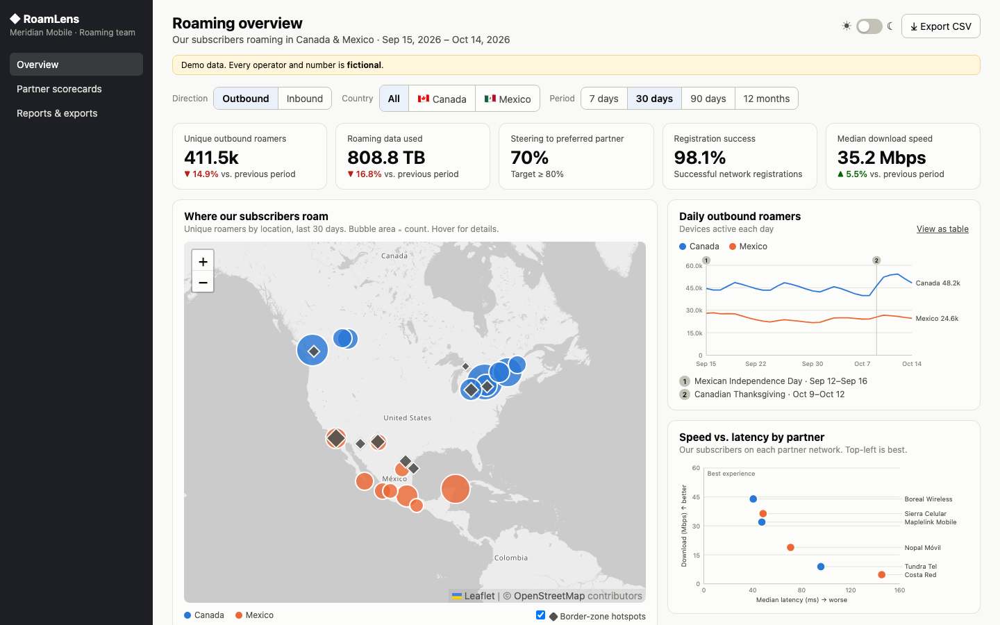
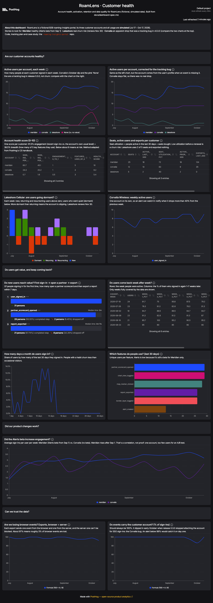
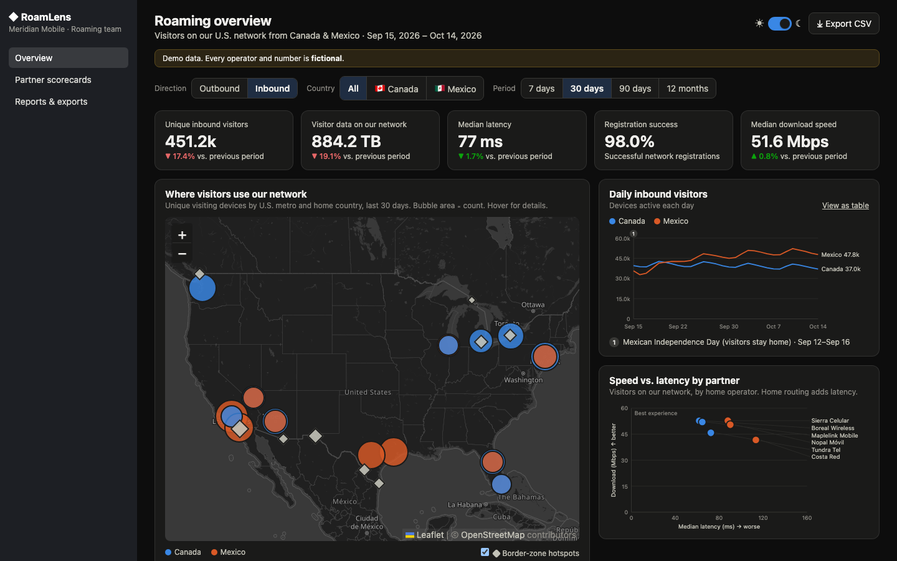
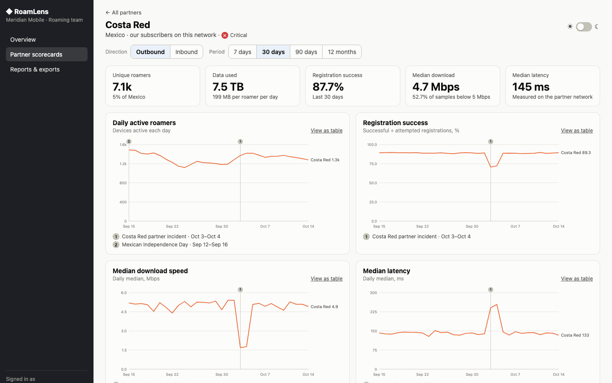

# RoamLens — a roaming-insights portal, instrumented with PostHog

I built a small B2B product, instrumented
it with PostHog the way I'd advise a customer to, and then supported it as if it were my customer:
account-health dashboards, a feature-flag rollout, error tracking, and a real data-quality investigation.

**Everything is fictional:** RoamLens, every operator and partner network, and every number. Names were
invented for this project; any resemblance to real companies is coincidental.

| | |
|---|---|
| **Live portal** | _link added after deployment_ |
| **Public PostHog dashboard** | [RoamLens · Customer health](https://us.posthog.com/shared/rKCshQtAb0WFpPF6O1YX_kG5SUu5JQ) |
| **Case study** | [Did Corvalia just churn?](docs/case-study.md): "usage dropped ~70%" turned out to be a tracking bug |
| **Tracking plan** | [Business questions → events → properties](docs/tracking-plan.md) |



## What it is

**The product.** RoamLens helps a U.S. mobile operator's roaming team see where its subscribers roam in
Canada and Mexico (outbound), who visits its network from there (inbound), which partner networks perform
well, and where border zones cause cross-border registrations. It runs on a 12-month synthetic dataset.

**The customer story.** RoamLens is the PostHog customer. Its customers are three fictional operators,
each with a story built into 90 days of simulated usage:

| Account | Story | What the data shows |
|---|---|---|
| Meridian Mobile | Healthy; got the **Alerts beta** (feature flag) on Sep 1 | Health score 10/10; engagement up after the rollout |
| Lakeshore Cellular | **Real churn risk** (renews Nov 30) | Sign-ins down from 14 to 2 a month; users going dormant |
| Corvalia Wireless | **Apparent 70% drop** after release 0.3.0 | A tracking bug on the SSO sign-in path, not churn ([case study](docs/case-study.md)) |

## What it demonstrates

- **Instrumentation designed from business questions:** a [tracking plan](docs/tracking-plan.md) first, enforced
  in code (`lib/analytics.ts` types every event, so an off-plan event doesn't compile).
- **Identity done carefully:** `identify` at sign-in, `reset` at sign-out, account context on every event, and a
  regression test for each sign-in path.
- **A customer investigation end to end:** reproduce → localize with annotations, breakdowns and SQL → confirm with
  independent evidence (server-side events, person properties) → root cause in code → fix + regression test →
  a [plain-language reply](docs/case-study.md#reply-to-the-customer) with prevention steps and a proactive churn heads-up.
- **Account health the way PostHog's CS team does it:** the health-score chart adapts the model from
  [PostHog's handbook](https://posthog.com/handbook/cs-and-onboarding/health-tracking), and explains where it had to change.
- **Cost and data hygiene:** free plan, no card, test traffic tagged and filtered, a pilot before any bulk send,
  rate-limit and alert recommendations.



## PostHog features used

| Feature | Where |
|---|---|
| Product analytics (trends, funnels, retention, stickiness, lifecycle, breakdowns) | [Dashboard](https://us.posthog.com/shared/rKCshQtAb0WFpPF6O1YX_kG5SUu5JQ), built by `scripts/build_dashboard.py` |
| SQL insights (HogQL) | Account health table, health score, retention matrix, case-study queries |
| Identify, person properties, reset | `components/Analytics.tsx`, `lib/identity.ts` |
| Groups (`group('company')`) | Called on every sign-in; `account_*` super properties are the free-plan alternative |
| Feature flags | `alerts-beta` gates the Alerts page (`components/AlertsBeta.tsx`) |
| Session replay | On, through the reverse proxy |
| Error tracking | Error boundaries + server `onRequestError` (`instrumentation.ts`) |
| Server-side capture (posthog-node) | `report_generated` from `/api/export`, sent with `after()` |
| Reverse proxy | `/lens-relay` rewrites in `next.config.ts` |
| Annotations, cohorts, dashboards, text cards, public sharing | Created by `scripts/build_dashboard.py` |
| Insight alerts, surveys | Designed in [the spec](docs/dashboard-spec.md) and [checklist](docs/posthog-setup-checklist.md) |

## Things I learned the hard way

Each of these came up while building the project, and each is a likely real-world support ticket.

1. **posthog-js drops events from headless browsers** (bot filtering). Automated tests sent nothing until the test
   browser used a normal user agent.
2. **Group analytics and historical imports are paid**, so I used account super properties, sent back-dated events
   as normal ingestion, and piloted 20 events before sending 9,600.
3. **The browser loses some events even behind a proxy.** Pairing each export with a server-side event measures it (~97%).
4. **React Strict Mode double-fires effects in development**, which duplicated mount-time events until I made them idempotent.
5. **A dashboard-level date filter overrides every tile's range**, so a "last 30 days" chart silently showed 90 days.
6. **Person properties on events reflect the person at ingestion time.** Events processed before `$identify`
   landed had an empty person snapshot; `coalesce(event property, person property)` covers both gaps.
7. **Batch-sent events are geolocated to the sender**, so all simulated "U.S." users appeared in one country.
8. **Native retention counts weeks after the data ends as 0%.** With frozen data that reads as churn, so the
   dashboard uses a SQL matrix of fully observed cohorts.
9. **A health score built on unique weekly users flatters small, intermittent accounts** (the handbook warns about
   this); frequency worked better for 3–5 seat teams.

## Architecture

```
 datagen/ (Python) ──► data/*.json ──► Next.js portal (app/, components/, lib/)
                                          │  posthog-js ──► /lens-relay (reverse proxy) ──► PostHog Cloud (US)
                                          └─ /api/export ── posthog-node (server event) ──►      ▲
 usagesim/ (Python) ── simulated usage (traffic_source_type = simulated) ───────────────────────┘
 scripts/build_dashboard.py ── PostHog API: insights, dashboard, annotations, cohorts
 scripts/audit_dashboard.py ── consistency checks on every chart (31 checks)
```

## Screenshots

| | |
|---|---|
|  |  |
| Inbound view, dark mode: Mexican visitors see higher latency (home routing) | Partner drill-down: the Oct 3–4 incident that the country average hides |

## Run it locally

Requirements: Node.js 20.9+ and Python 3.9+.

```bash
npm install
cp .env.example .env.local   # add a PostHog project token, or leave it out to run without analytics
npm run dev                  # http://localhost:3000, then pick a demo account and role
```

Data, simulation and checks (Python):

```bash
python3 -m venv .venv && .venv/bin/pip install -r requirements.txt
npm run data                 # regenerate the roaming dataset (deterministic)
npm run test:data            # 44 pytest tests: dataset integrity, scenario stories, simulator
npm test                     # 36 vitest tests: selectors, CSV, session, identity regression tests
.venv/bin/python -m usagesim                      # simulated usage, dry run (add --send to send)
.venv/bin/python scripts/build_dashboard.py       # build the PostHog dashboard (needs a personal API key)
.venv/bin/python scripts/audit_dashboard.py       # check every chart for consistency
node scripts/verify-tracking.mjs --account corvalia   # drive a real browser session and decode every event sent
```

## Repository

| Path | What |
|---|---|
| `app/`, `components/`, `lib/` | Next.js portal: pages, map and charts, data selectors, analytics, identity |
| `datagen/` | Synthetic roaming dataset generator ([data dictionary](docs/data-dictionary.md)) |
| `usagesim/` | Simulated portal usage with the three account stories |
| `scripts/` | Dashboard builder and audit, tracking verification, screenshots |
| `tests/` | pytest and vitest suites |
| `docs/` | [Case study](docs/case-study.md), [dashboard spec](docs/dashboard-spec.md), [tracking plan](docs/tracking-plan.md), [data dictionary](docs/data-dictionary.md), [setup checklist](docs/posthog-setup-checklist.md), [project plan](docs/project-plan.md), [design mockup](docs/mockups/portal-mockup.html) |

The incident is visible in the git history: `Release 0.3.0: login refactor` introduces the bug, and
`Release 0.3.1: register account properties for SSO sign-ins` fixes it with regression tests.

Built with Claude Code as a pair programmer.

## License

[MIT](LICENSE). The data, companies and people in this project are fictional.
